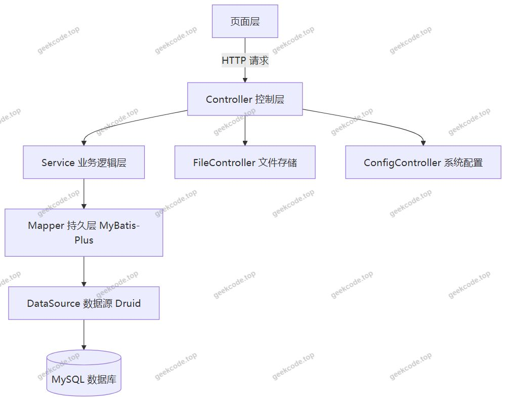
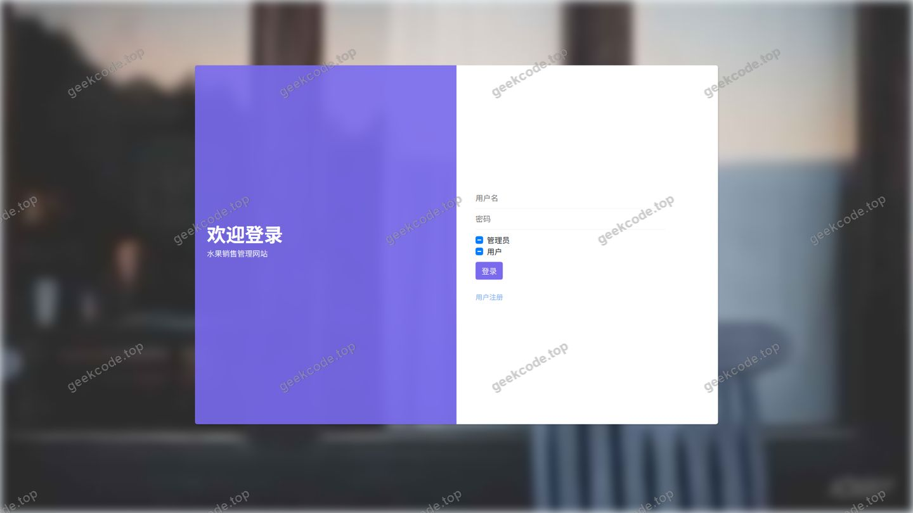
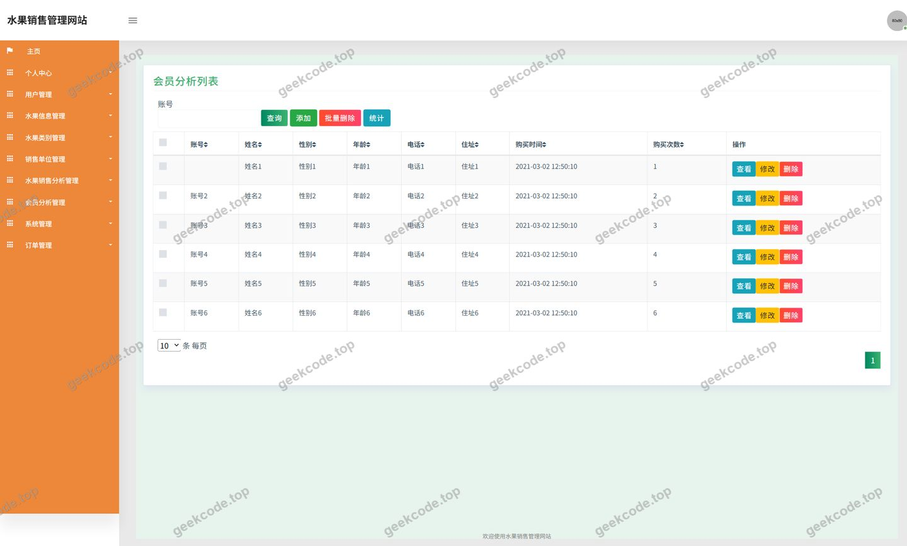
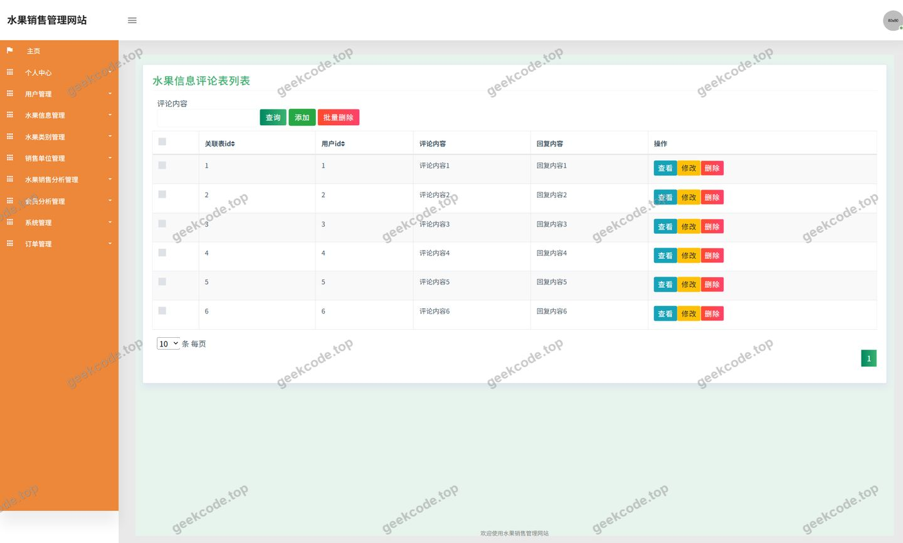
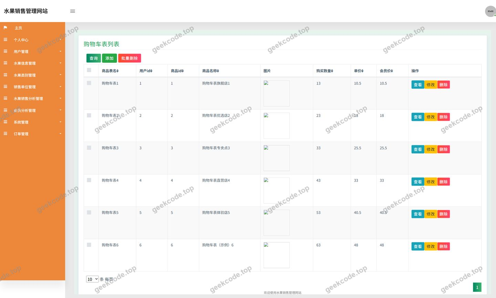
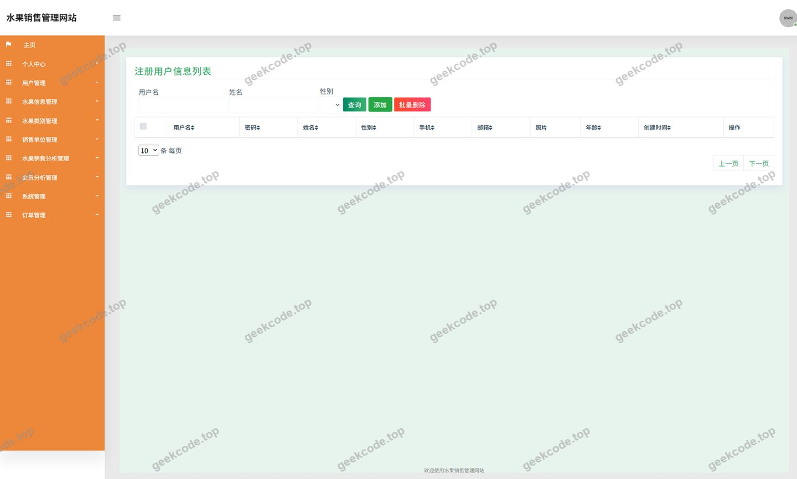
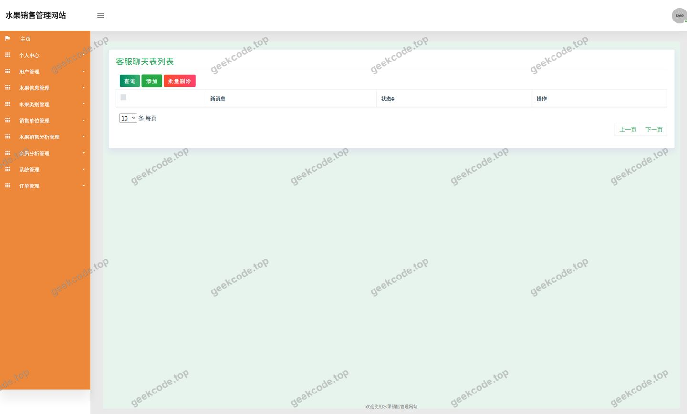
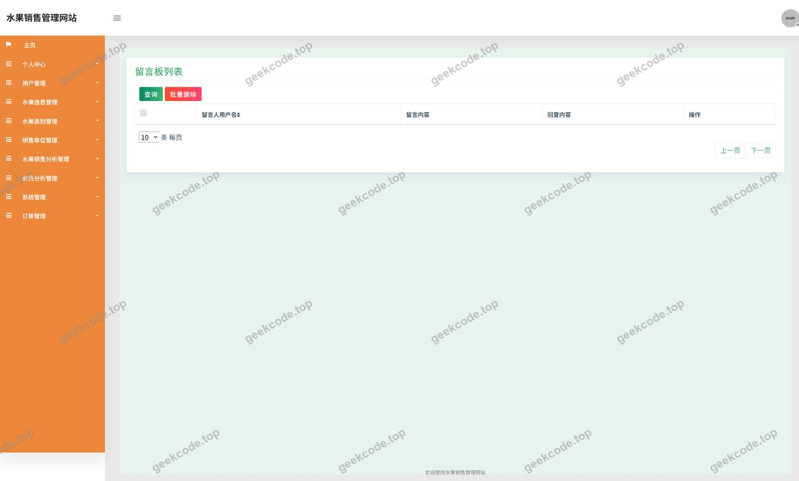
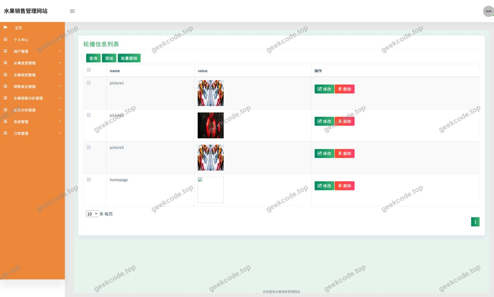
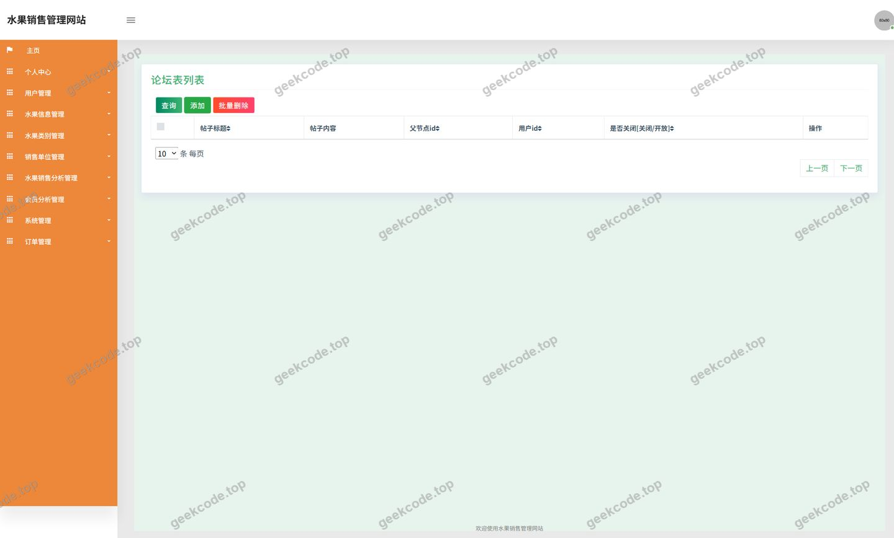

# java项目水果销售管理网站java毕业设计

> 🎓 **计算机毕业设计 · java项目水果销售管理网站java毕业设计**
>
> 本仓库只放**项目介绍 + 运行截图**（截图是站点带水印的原图，存在仓库 `images/` 里）。
>
> 👉 **完整可运行源码 / 数据库脚本 / 部署文档：[点我获取](https://geekcode.top/archives/java%E9%A1%B9%E7%9B%AE%E6%B0%B4%E6%9E%9C%E9%94%80%E5%94%AE%E7%AE%A1%E7%90%86%E7%BD%91%E7%AB%99java%E6%AF%95%E4%B8%9A%E8%AE%BE%E8%AE%A1?utm_source=github)**
>
> 💬 咨询微信：**ir9372**　|　🌐 更多项目：[极客代码 geekcode.top](https://geekcode.top/?utm_source=github)
>
> 📌 项目详情页：<https://geekcode.top/archives/java%E9%A1%B9%E7%9B%AE%E6%B0%B4%E6%9E%9C%E9%94%80%E5%94%AE%E7%AE%A1%E7%90%86%E7%BD%91%E7%AB%99java%E6%AF%95%E4%B8%9A%E8%AE%BE%E8%AE%A1?utm_source=github>

<table><td width="230" align="center"> <b>扫码加微信 ir9372</b></td><td valign="middle">📦 源码 = 项目介绍 + 全部运行截图 + 数据库 + 部署文档 👉 点上方任意截图，直接跳到 <b>极客代码 geekcode.top</b> 详情页</td></table>

---

<h1>java项目_水果销售管理网站_java毕业设计</h1>
<h2>项目概述</h2>

本项目是一个基于 Java 技术栈实现的水果销售管理网站，以纯接口服务的形式对外提供数据访问能力，覆盖水果商品从信息发布到订单成交的完整业务链路。系统核心功能包括水果信息与类别管理、购物车、收货地址、订单处理、水果信息评论、新闻资讯发布，以及面向运营的会员分析和水果销售分析等统计模块；同时提供文件上传下载、系统配置等公共支撑能力。适用人群包括需要进行水果商品线上展示与销售管理的商家，以及通过网站浏览水果信息、下单购买、管理个人订单与地址的会员用户。技术架构采用 Spring 体系（spring-core、spring-context、spring-webmvc、spring-jdbc 等）构建分层 Web 应用，持久层使用 MyBatis-Plus 简化数据访问，数据库连接池采用 Druid 提供监控与性能保障，整体符合典型 Java Web 毕业设计的技术规范与交付形态。

<h2>技术架构</h2>
<h3>总体架构</h3>

项目采用前后端分离的接口服务架构，项目类型为纯接口（pure-api）服务端，后端统一暴露数据访问接口，页面通过调用接口完成数据交互。

<h3>分层设计</h3>
<ul>
<li><strong>控制层</strong>：由 12 个 Controller 组成，按业务域划分，包括 <code>ShuiguoxinxiController</code>（水果信息）、<code>ShuiguoleibieController</code>（水果类别）、<code>OrdersController</code>（订单）、<code>CartController</code>（购物车）、<code>AddressController</code>（收货地址）、<code>NewsController</code>（新闻资讯）、<code>DiscussshuiguoxinxiController</code>（水果信息评论）、<code>HuiyuanfenxiController</code>（会员分析）、<code>ShuiguoxiaoshoufenxiController</code>（水果销售分析）、<code>FileController</code>（文件上传下载）、<code>ConfigController</code>（配置）、<code>CommonController</code>（公共接口）。</li>
<li><strong>持久层</strong>：基于 MyBatis-Plus，通过通用 Mapper 完成单表增删改查，减少样板 SQL 代码；复杂统计查询（会员分析、销售分析）在 Mapper 中编写自定义语句。</li>
<li><strong>数据源层</strong>：使用 Druid 连接池管理数据库连接，提供连接池监控与 SQL 执行性能观测能力。</li>
<li><strong>基础设施</strong>：依赖中包含 <code>spring-tx</code> 提供声明式事务管理，<code>spring-aop</code> 支持切面编程，<code>spring-context-support</code> 提供缓存等上下文支持，<code>junit</code> 用于单元测试。</li>
</ul>
<h3>数据库设计要点</h3>

数据模型围绕水果销售业务主体展开，主要实体包括：

<ul>
<li><strong>水果信息表</strong>：存储水果名称、类别、价格、库存、图片等商品主数据，是前台展示与下单的基础。</li>
<li><strong>水果类别表</strong>：与水果信息构成一对多关联，支持按类别检索商品。</li>
<li><strong>水果信息评论表</strong>：记录会员对具体水果信息的评论内容，关联水果信息与用户。</li>
<li><strong>订单表</strong>：记录订单编号、下单用户、商品明细、金额、订单状态等，是交易链路的核心。</li>
<li><strong>购物车表</strong>：记录用户待结算商品的临时数据。</li>
<li><strong>收货地址表</strong>：记录用户的收货人、联系电话、详细地址等信息，与订单关联。</li>
<li><strong>新闻资讯表</strong>：存储网站新闻资讯内容，支撑前台“新闻资讯”栏目。</li>
<li><strong>会员与销售分析数据</strong>：为 <code>HuiyuanfenxiController</code> 与 <code>ShuiguoxiaoshoufenxiController</code> 提供统计维度的基础数据支撑。</li>
<li><strong>配置表与文件表</strong>：分别支撑系统参数配置与上传文件的元数据管理。</li>
</ul>

表间关系以用户、水果信息、订单为核心枢纽，订单关联用户与水果信息，评论关联用户与水果信息，地址关联用户，形成完整的业务闭环。

<h3>核心技术选型理由</h3>
<ul>
<li><strong>Spring 体系</strong>：通过 IoC 容器统一管理 Bean 依赖，<code>spring-webmvc</code> 提供请求分发与参数绑定能力，<code>spring-tx</code> 保证订单等关键业务的事务一致性，模块化依赖便于按需组合。</li>
<li><strong>MyBatis-Plus</strong>：在 MyBatis 基础上提供通用 CRUD 与条件构造器，显著降低单表操作的代码量，同时保留自定义 SQL 的能力，适合既有常规增删改查又有统计分析需求的销售管理类系统。</li>
<li><strong>Druid</strong>：除连接池功能外，内置监控统计能力，便于在开发与答辩演示阶段直观展示数据库访问性能。</li>
<li><strong>JUnit</strong>：为业务逻辑提供单元测试支撑，保障核心接口的正确性。</li>
</ul>
<h2>功能模块</h2>
<h3>用户端功能模块</h3>
<ul>
<li><strong>登录</strong>：用户身份认证入口，登录后进入个人中心与下单流程。</li>
<li><strong>水果信息</strong>：浏览水果商品列表与详情，支持按水果类别筛选，查看商品评论。</li>
<li><strong>新闻资讯</strong>：浏览网站发布的新闻资讯内容。</li>
<li><strong>个人中心</strong>：维护个人账户信息。</li>
<li><strong>我的订单</strong>：查看本人订单记录与订单状态。</li>
<li><strong>我的地址</strong>：新增、修改、删除收货地址，为下单提供配送信息。</li>
<li><strong>我的收藏</strong>：管理本人收藏的水果商品。</li>
<li><strong>购物车</strong>：将水果商品加入购物车、调整数量、进行结算。</li>
<li><strong>水果信息评论</strong>：对已浏览的水果信息发表评论。</li>
<li><strong>文件上传下载</strong>：通过文件接口上传与获取图片等资源。</li>
</ul>
<h3>管理端功能模块</h3>
<ul>
<li><strong>用户管理</strong>：查看与维护系统用户信息，包含默认用户（defaultuser）相关管理页面。</li>
<li><strong>水果信息管理</strong>：新增、修改、删除、查询水果商品信息。</li>
<li><strong>水果类别管理</strong>：维护水果类别字典，为商品分类提供基础数据。</li>
<li><strong>水果信息评论管理</strong>：审核与管理用户提交的水果商品评论。</li>
<li><strong>订单管理</strong>：查询订单、跟踪订单状态、处理订单业务。</li>
<li><strong>新闻资讯管理</strong>：发布、编辑、删除新闻资讯内容。</li>
<li><strong>会员分析</strong>：基于会员数据生成统计分析结果，辅助运营决策。</li>
<li><strong>水果销售分析</strong>：基于销售数据生成统计分析结果，反映商品销售情况。</li>
<li><strong>客服管理</strong>：管理与处理客服相关业务记录。</li>
<li><strong>留言板管理</strong>：查看与管理用户留言内容。</li>
<li><strong>轮播图管理</strong>：维护前台首页轮播图资源。</li>
<li><strong>论坛管理</strong>：管理论坛板块与帖子内容。</li>
<li><strong>文件管理</strong>：统一管理系统中上传的文件资源。</li>
<li><strong>系统配置</strong>：维护系统运行所需的配置参数。</li>
</ul>
<h2>用户角色与权限</h2>
<h3>管理员</h3>

管理员为系统后台的运营与维护角色，可访问以下功能模块：

<ul>
<li>用户管理：查看用户列表、维护用户信息。</li>
<li>水果信息管理：水果商品的增删改查。</li>
<li>水果类别管理：类别字典的维护。</li>
<li>水果信息评论管理：评论内容的查看与处理。</li>
<li>订单管理：订单查询与状态处理。</li>
<li>新闻资讯管理：资讯内容的发布与维护。</li>
<li>会员分析：查看会员维度的统计分析。</li>
<li>水果销售分析：查看销售维度的统计分析。</li>
<li>客服管理：处理客服业务记录。</li>
<li>留言板管理：查看与管理留言。</li>
<li>轮播图管理：维护首页轮播资源。</li>
<li>论坛管理：维护论坛内容。</li>
<li>文件管理：管理上传文件资源。</li>
<li>系统配置：维护系统参数。</li>
</ul>
<h3>会员用户</h3>

会员用户为系统的前台使用角色，可访问以下功能模块：

<ul>
<li>登录：进行身份认证。</li>
<li>水果信息：浏览水果商品列表与详情。</li>
<li>新闻资讯：浏览网站资讯内容。</li>
<li>个人中心：查看与维护个人账户信息。</li>
<li>我的订单：查看本人订单。</li>
<li>我的地址：维护本人收货地址。</li>
<li>我的收藏：管理本人收藏的商品。</li>
<li>购物车：管理待结算商品并下单。</li>
<li>水果信息评论：对水果商品发表评论。</li>
</ul>
<h2>项目特色与创新点</h2>
<ul>
<li><strong>业务闭环完整</strong>：从水果信息展示、加入购物车、填写收货地址到生成订单，形成完整的线上销售链路，同时配套评论、收藏等增强用户粘性的功能。</li>
<li><strong>数据驱动的运营支撑</strong>：专门设置会员分析与水果销售分析两个统计模块，将分散的交易与用户数据转化为可读的运营指标，为商品结构优化提供依据。</li>
<li><strong>公共能力沉淀</strong>：通过 <code>CommonController</code>、<code>ConfigController</code>、<code>FileController</code> 将公共接口、系统配置、文件管理等通用能力独立抽取，避免在各业务模块中重复实现，提升代码可维护性。</li>
<li><strong>连接池可视化监控</strong>：引入 Druid 连接池，可在运行期观测数据库连接状态与 SQL 执行情况，便于性能排查与教学演示。</li>
<li><strong>分层清晰、职责单一</strong>：控制器按业务域严格划分，每个 Controller 对应一个业务实体，命名直观，便于后续功能扩展与毕业设计文档追溯。</li>
</ul>
<h2>部署环境</h2>
<ul>
<li><strong>JDK</strong>：需安装 JDK（建议 1.8 及以上版本），用于编译与运行 Java 代码。</li>
<li><strong>Maven</strong>：用于管理 <code>spring-core</code>、<code>spring-webmvc</code>、<code>spring-jdbc</code>、<code>spring-tx</code>、<code>spring-aop</code>、<code>spring-context-support</code>、<code>mybatis-plus</code>、<code>druid</code>、<code>junit</code> 等项目依赖并完成构建打包。</li>
<li><strong>MySQL</strong>：作为业务数据存储数据库，需提前创建数据库并导入建表脚本与初始数据。</li>
<li><strong>Servlet 容器</strong>：项目基于 <code>spring-webmvc</code> 构建，需部署运行于支持 Servlet 规范的 Web 容器（如 Tomcat）。</li>
<li><strong>Druid 监控</strong>：数据库连接池随应用启动自动生效，可通过 Druid 提供的监控入口查看连接池与 SQL 统计信息。</li>
<li><strong>浏览器</strong>：用于访问系统页面并调用后端接口。</li>
</ul>
<h2>五、技术特性</h2>
<ul>
<li>使用 MyBatis-Plus 简化数据访问层开发</li>
</ul>
<h2>六、功能模块截图</h2>
<h3>后台管理端</h3>
<h4>页面-登录</h4>

<h4>页面-会员分析</h4>

<h4>页面-水果信息评论</h4>

<h4>页面-用户</h4>

<h4>页面-defaultuser</h4>

<h4>页面-kefuguanli</h4>

<h4>页面-liuyanbanguanli</h4>

<h4>页面-lunbotuguanli</h4>

<h4>页面-luntanguanli</h4>

---

## 获取完整源码

| 项目 | 说明 |
| --- | --- |
| 项目名 | java项目水果销售管理网站java毕业设计 |
| 运行截图 | 本文 10 张（站点带水印原图，仓库 `images/` 目录） |
| 完整源码 | [https://geekcode.top/archives/java%E9%A1%B9%E7%9B%AE%E6%B0%B4%E6%9E%9C%E9%94%80%E5%94%AE%E7%AE%A1%E7%90%86%E7%BD%91%E7%AB%99java%E6%AF%95%E4%B8%9A%E8%AE%BE%E8%AE%A1?utm_source=github](https://geekcode.top/archives/java%E9%A1%B9%E7%9B%AE%E6%B0%B4%E6%9E%9C%E9%94%80%E5%94%AE%E7%AE%A1%E7%90%86%E7%BD%91%E7%AB%99java%E6%AF%95%E4%B8%9A%E8%AE%BE%E8%AE%A1?utm_source=github) |
| 咨询微信 | **ir9372**（备注：jingpin-yuanma） |
| 更多项目 | [极客代码 geekcode.top](https://geekcode.top/?utm_source=github) |

> 需要源码、部署、改配置、跑不起来等问题，加微信 ir9372 沟通，说明项目名即可。
